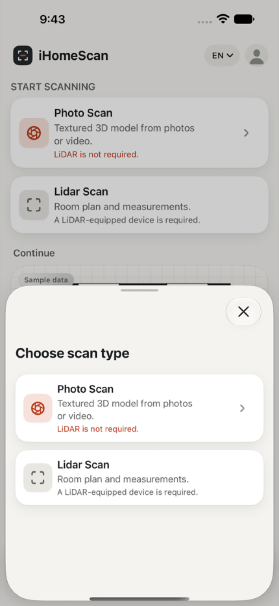
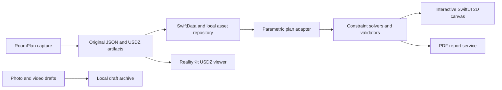

# iHomeScan

iHomeScan is a native SwiftUI application for RoomPlan-based room capture and parametric refinement of architectural floor plans.

## Overview

Mobile LiDAR is excellent for producing an initial spatial model, but an as-built drawing still benefits from measurements that can be checked and corrected. iHomeScan keeps the original RoomPlan artifacts intact while building an editable precision document on top of them. Users can review a reconstructed 2D plan, revise dimensions, edit doors and windows, add structural elements, inspect the original 3D capture, and generate a measurement report.

The current application also includes a photo-capture draft workflow. It can securely collect and organize photos or a short video, but photo-to-3D reconstruction is not implemented yet.

## Application Preview

Authentic English-language simulator screenshots are shown below. LiDAR capture itself requires supported physical hardware.

| Home and scan choices | Scan method sheet | PhotoScan draft entry |
|---|---|---|
|  |  |  |

## Current Features

- RoomPlan capture with device-readiness and camera-permission handling
- Immutable storage of original CapturedRoom JSON, floor-plan JSON, and USDZ artifacts
- SwiftData project, floor, room, scan, and report persistence
- Parametric 2D floor plans with shared vertices and wall topology
- Local wall-length revision with validation, conflict protection, undo, and redo
- Door and window placement, dimensions, provenance, and vertical measurement relationships
- Rectangular, square, and circular columns plus overhead beam geometry
- Structural element creation, selection, dragging, and inline property editing
- Pan, zoom, rotation, fit-to-screen, hit testing, and dimension annotation rendering
- Original RoomPlan USDZ visualization with RealityKit and Quick Look
- PDF measurement report generation, preview, and sharing
- Localized Uzbek, English, and Russian interfaces
- Photo/video draft capture and import for a future reconstruction workflow

See [FEATURES.md](docs/FEATURES.md) for verified status and limitations.

## Technology Stack

- Swift and SwiftUI
- SwiftData with a versioned migration plan
- RoomPlan for supported-device room capture
- RealityKit and Quick Look for original USDZ visualization
- PDFKit and UIKit PDF rendering for reports
- AVFoundation, PhotosUI, ImageIO, and Uniform Type Identifiers for photo-scan drafts
- CryptoKit for persisted artifact integrity checks
- Custom computational geometry, constraint resolution, validation, and Canvas rendering

Core ML and CoreBluetooth are not integrated in the current codebase. The app does not directly import ARKit; RoomPlan provides the capture framework used by the product.

## Architecture



The precision document is the authoritative edited geometry. Original scan artifacts remain source evidence and are not rewritten. See [ARCHITECTURE.md](docs/ARCHITECTURE.md) for details.

## Getting Started

### Requirements

- macOS with a current Xcode release capable of building the project
- iOS 17.6 or later for the application target
- A LiDAR-equipped iPhone or iPad for RoomPlan capture

### Build

1. Clone the private repository.
2. Open `iHomeScan.xcodeproj` in Xcode.
3. Select the `iHomeScan` scheme.
4. Choose an iOS Simulator for browsing persisted/sample content, or a supported physical device for RoomPlan capture.
5. Build and run.

The simulator can exercise navigation, editing, persistence, reports, and photo drafts, but it cannot perform a real LiDAR room capture.

## Testing

The project contains Swift Testing unit tests and XCUITest coverage. In Xcode, use **Product → Test**, or run:

```bash
xcodebuild test \
  -project iHomeScan.xcodeproj \
  -scheme iHomeScan \
  -destination 'platform=iOS Simulator,name=iPhone 15 Pro Max'
```

Destination availability depends on installed simulator runtimes. Verified results for the published revision are recorded in the final publication report, not assumed here.

## Roadmap

Planned work includes measurement workflows with commercial Bluetooth laser meters, photo-based 3D reconstruction, edited 2D/3D synchronization, stronger geometry verification, and professional exchange formats such as DXF/IFC. These are not presented as completed functionality. See [ROADMAP.md](docs/ROADMAP.md).

## Project Status

Actively developed as an independent iOS engineering project. Hardware-dependent RoomPlan behavior must be validated on a supported physical device.

## Author and Ownership

Independently developed by [Azizbek Kakhkharov](https://github.com/tasvirlab). iHomeScan is not affiliated with or endorsed by Apple Inc.

No open-source license is granted by this repository.
