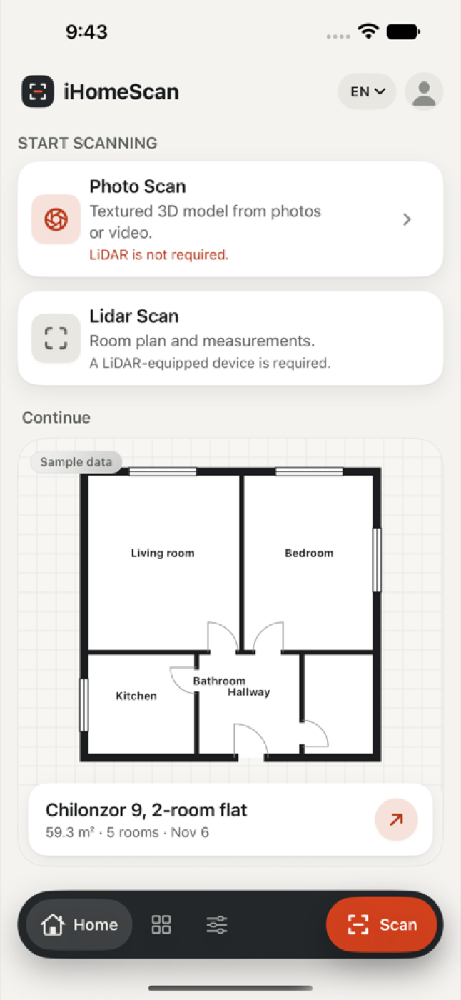
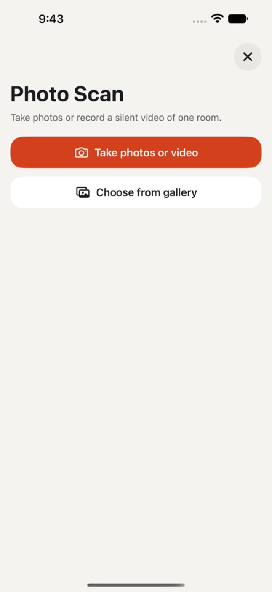
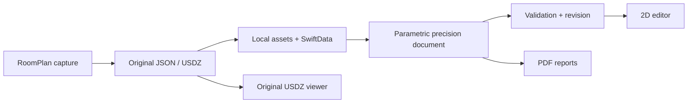

# iHomeScan

A native iOS application for LiDAR room capture and parametric 2D floor-plan editing.

iHomeScan uses Apple's RoomPlan to capture an initial room layout, preserves the original scan artifacts, and provides an editable precision document for reviewing and correcting measurements. The app focuses on traceable geometry changes rather than treating a mobile scan as a final as-built drawing.

## Application Preview

These are screenshots of the current English-language app running in the iPhone Simulator. LiDAR capture requires a supported physical device.

| Home | Scan methods | PhotoScan drafts |
|---|---|---|
|  |  |  |

## Features

- **Room capture:** RoomPlan scanning with device checks, permission handling, and preservation of the source JSON and USDZ artifacts.
- **Parametric floor plans:** Editable walls and shared vertices, hosted doors and windows, structural columns, and overhead beams.
- **Precision editing:** Wall-length corrections, opening and structural measurements, constraint validation, previews, undo/redo, and measurement provenance.
- **2D interaction:** Canvas-based rendering, dimensions, selection, pan, zoom, rotation, and fit-to-screen.
- **Projects and reports:** Local SwiftData persistence, source-asset integrity checks, and PDF measurement reports.
- **3D reference:** View the **original** RoomPlan USDZ with RealityKit and Quick Look.
- **PhotoScan drafts:** Capture/import and organize local media; photo-to-3D reconstruction is not yet implemented.
- **Localization:** English, Uzbek, and Russian.

See [feature status](docs/FEATURES.md) for implementation boundaries.

## Technology

| Area | Implementation |
|---|---|
| App and UI | Swift, SwiftUI, SwiftUI Canvas |
| Room capture | RoomPlan |
| Data and files | SwiftData, versioned schemas, local artifact storage, CryptoKit |
| Geometry | Custom parametric model, constraint solvers, and validators |
| 3D reference | RealityKit, Quick Look |
| Reports | PDFKit, UIKit PDF rendering |
| Media drafts | AVFoundation, PhotosUI, ImageIO |

Core ML inference and Bluetooth laser-meter connectivity are **not** currently integrated.

## Architecture

The original scan is retained independently of the edited floor-plan document. Geometry changes are validated before becoming the current precision state; the 2D editor and PDF reporting consume that state. The 3D viewer still displays the original capture, **not** a regenerated model of the edits.

Read the [architecture guide](docs/ARCHITECTURE.md) for data flow, persistence, and geometry details.

## Getting Started

**Requirements:** macOS with a compatible Xcode version; iOS 17.6 or later for the app target. Live RoomPlan capture requires a LiDAR-capable iPhone or iPad.

1. Clone this private repository.
2. Open `iHomeScan.xcodeproj` in Xcode.
3. Select the `iHomeScan` scheme and a compatible iPhone Simulator or physical device.
4. Build and run. A simulator supports non-LiDAR editing and preview flows but cannot perform RoomPlan capture.

For build and test commands, see [Development](docs/DEVELOPMENT.md).

## Current Limitations

- Edits to the 2D precision document do not regenerate the RoomPlan USDZ.
- Commercial Bluetooth laser-meter integration, Core ML reconstruction, and CAD/BIM export are not implemented.
- Hardware capture and measurement accuracy require validation on physical devices.

See the [roadmap](docs/ROADMAP.md) for planned work.

---

Personal iOS engineering project maintained by [tasvirlab](https://github.com/tasvirlab). No open-source license is provided.
